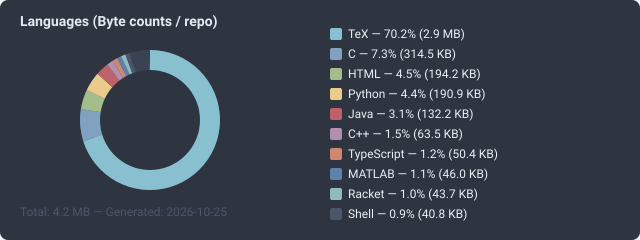
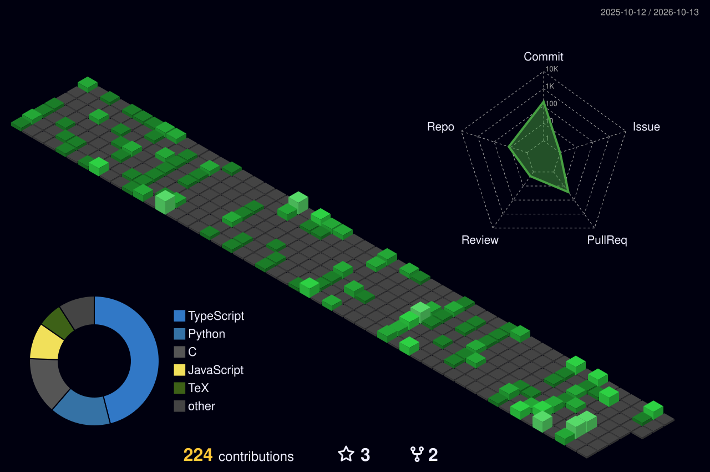

## Hi there 👋, I'm Daniel

**From an academic perspective**:

- I'm currently pursuing a Bachelor of Science degree in CS in Bucharest (3rd Year)
- Member of the [Systems Laboratory](https://github.com/systems-cs-pub-ro/) group, contributing to teaching materials and lab infrastructure
- Undergraduate teaching assistant @ACS-UNSTPB: Introduction in Linux (USO) and Operating Systems (SO)

**On a more personal note**:

- Open Source enthusiast
- Member of the [ROSEdu](https://www.rosedu.org/) organisation, involved in Open Source in Romania
- Helped as an [Obsidian](https://obsidian.md/) app UI localiser for Romanian
- Interested in videogames, posted personal passion projects on [my GitHub Pages](https://danieldyn.github.io/)

## Languages and GitFut Stats

## 3D Contribution Graph

